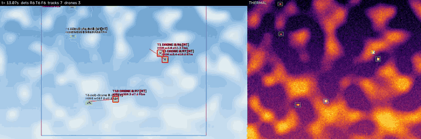
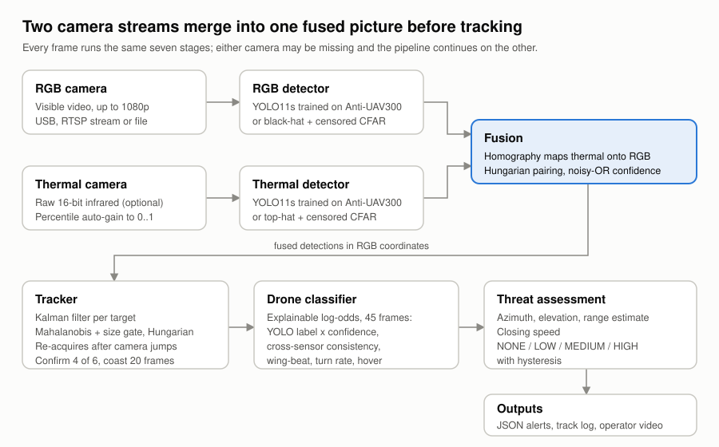
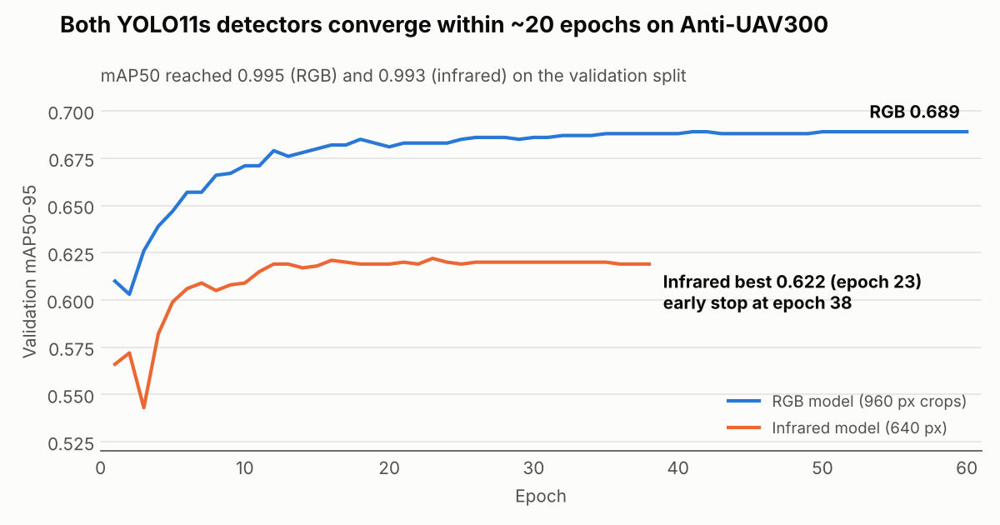
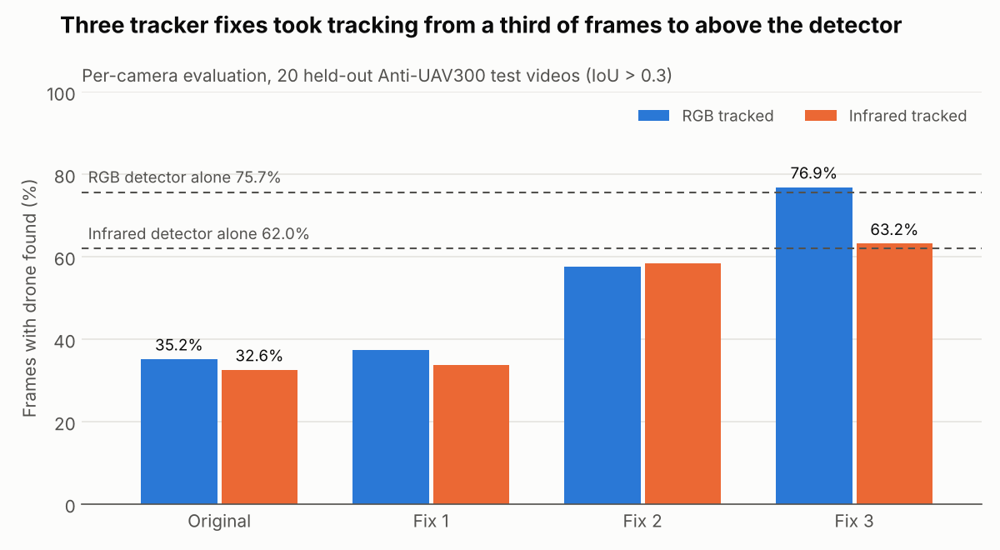
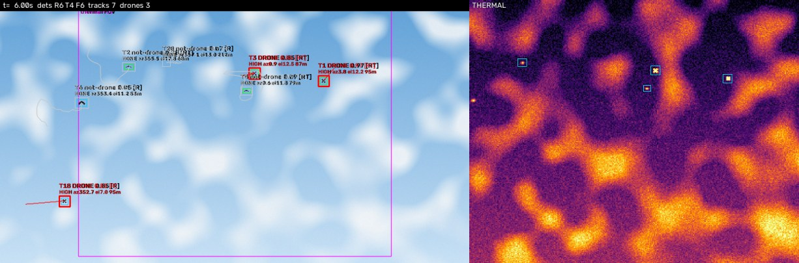
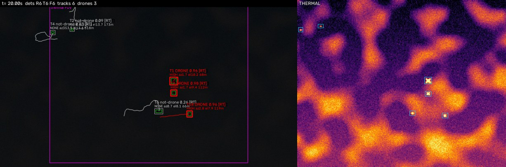

# Counter-Drone Detection & Tracking (RGB + Thermal)

Real-time detection, tracking, identification and threat assessment of small drones from a
visible (RGB) camera and a thermal (infrared) camera, with YOLO11 models trained on the real
**Anti-UAV300** benchmark.



*Operator view on the built-in simulation. Left: annotated RGB. Right: false-colour thermal.
Drones are red `DRONE` tracks with threat level, bearing and range. Birds are grey `not-drone`.
As dusk falls the RGB image goes dark and tracking continues on thermal alone.*

## Highlights

- **Two sensors, one picture:** RGB and thermal detections are aligned through a calibrated
  homography and fused. Either camera can drop out and tracking continues on the other.
- **Trained on real drones:** YOLO11s detectors fine-tuned on Anti-UAV300 (about 58,000 RGB and
  infrared training images) reach **mAP50 0.995 (RGB) and 0.993 (infrared)** on validation.
- **Tracking that beats the detector:** on 20 held-out Anti-UAV test videos the tracked system
  finds the drone in **76.9% of RGB and 63.2% of infrared frames**, more than YOLO alone, because
  it keeps the detector's hits and bridges the frames it misses.
- **Stable on real camera motion:** one track ID held through a full 30-second test video
  despite a gimbal that repeatedly jerks the drone across the frame.
- **Explainable decisions:** every track carries a breakdown of why it is or isn't a drone
  (detector confidence, cross-sensor consistency, wing-beat, turn rate, hover).
- **Operator outputs:** azimuth, elevation, estimated range, closing speed, and
  NONE / LOW / MEDIUM / HIGH threat levels, emitted as JSON alerts and an annotated video.
- **Runs in real time** on a laptop RTX 5050 (YOLO inference 2.6 ms infrared, 7.1 ms RGB per image).
- **Tested:** 31 automated tests, including a regression test for every tracker fix.

## How it works



| Stage | Method |
|---|---|
| **Detection** | YOLO11s per camera, trained on Anti-UAV300. A training-free fallback for clean sky: morphological black-hat / top-hat saliency with a censored CFAR threshold (adapts to cloud clutter without one drone masking another). |
| **Fusion** | Thermal boxes mapped into the RGB image by a homography (calibrated from points, a heated checkerboard, or the dataset's own label tracks); Hungarian pairing; noisy-OR confidence. |
| **Tracking** | Constant-velocity Kalman filter per target; Mahalanobis gate plus a size-relative gate for jerky camera motion; re-acquisition after gimbal jumps; M-of-N confirmation; coasting through dropouts. |
| **Classification** | Log-odds evidence over 45 frames: detector label weighted by confidence, cross-sensor consistency, wing-beat (aspect oscillation), turn rate, hover. Thermal brightness is deliberately not used, since birds are warm too. |
| **Threat** | Pinhole geometry gives bearing and elevation; range from apparent size; closing speed by regression; levels with hysteresis so alerts don't flicker. |

## Results

### Detectors (Anti-UAV300 validation split)

| Model | Input | Precision | Recall | mAP50 | mAP50-95 | Inference |
|---|---|---|---|---|---|---|
| Infrared YOLO11s | 640 px full frame | 0.993 | 0.987 | 0.993 | 0.621 | 2.6 ms |
| RGB YOLO11s | 960 px native-resolution crops | 0.992 | 0.989 | 0.995 | 0.689 | 7.1 ms |



### Full system on held-out test videos



Measured per camera on 20 Anti-UAV300 test sequences (up to 600 frames each) with the official
Anti-UAV accuracy metric, which also penalises reporting a drone that isn't there:

| Camera | Detector alone: found / accuracy | **Tracked system: found / accuracy** |
|---|---|---|
| RGB | 75.7% / 0.508 | **76.9% / 0.525** |
| Infrared | 62.0% / 0.392 | **63.2% / 0.410** |

Each tracker fix was found by reproducing the real failure in a simulation, then locked in
with a regression test that fails on the previous code: the matching gate was too tight for big,
close drones; jerky motion from a chasing camera fragmented tracks; weak false boxes carried the
same "drone" label; and the reported target didn't follow the detector when it was confident.

### Simulation benchmark

| | Day | Dusk (RGB nearly blind) |
|---|---|---|
| Drones declared (p ≥ 0.7) | 94.6% | **100%** (thermal carries the tracks) |

100% detection recall, **0 birds** declared as drones, 0 identity switches, each drone declared
within 1.1 to 1.4 s, about 40 ms per frame on one CPU core (30 s scene, 3 drones, 3 birds,
drifting clouds, sensor noise).

| Daylight | Dusk |
|---|---|
|  |  |

## Quick start

```bash
pip install -r requirements.txt
python -m counter_drone demo --out runs/demo        # simulation, scored against ground truth
python -m pytest -q tests
```

With trained models and a webcam (YOLO mode, GPU):

```bash
python -m counter_drone run --rgb 0 --rgb-yolo runs/yolo/anti_uav_rgb/weights/best.pt \
  --yolo-mode yolo --yolo-device 0 --rgb-imgsz 1280 --yolo-conf 0.5 --display --out runs/webcam --record
```

Alerts print as JSON lines, ready to pipe into another system:

```json
{"t": 0.85, "track_id": 1, "level": "HIGH", "previous": "LOW", "drone_prob": 0.711, "azimuth_deg": 2.99, "elevation_deg": 10.89, ...}
```

## Research dashboard (login, roles, live view)

`dashboard/` is a small Flask site around the detector: signed-in users see the annotated video, a sky-dome
plot and the alert feed update live, and admins start and stop the detector on a named server-side source.
Research use only. Run it from the repository root, as a single server process:

```bash
python -m dashboard.app create-user --role admin     # prompts for a username and a 12+ character password
python -m dashboard.app serve --port 5000             # then open http://127.0.0.1:5000
```

Sources are an allowlist of names on the server (default: the first three Anti-UAV300 test clips; override with
`DASHBOARD_SOURCES='{"name": "path-or-rtsp-url"}'`). The browser never sends a path or URL. YOLO weights default to
`runs/yolo/anti_uav_rgb/weights/best.pt` on the GPU when present (`DASHBOARD_YOLO_WEIGHTS`, or
`DASHBOARD_BACKEND=classical` to skip them). Serve over HTTPS before using it on a network.

## Train on Anti-UAV300 with a GPU (one command)

[Anti-UAV300](https://github.com/ZhaoJ9014/Anti-UAV) provides paired RGB and infrared videos
of real drones with per-frame boxes and a held-out test split.
`scripts/train_anti_uav.py` downloads it, converts it, trains both models, and evaluates the full
pipeline. It resumes after interruptions and accepts a time budget (`--hours`).

```bash
# RTX 50-series GPUs need a CUDA 12.8+ PyTorch build
pip install torch torchvision --index-url https://download.pytorch.org/whl/cu128
pip install -r requirements.txt ultralytics gdown
python scripts/train_anti_uav.py --download          # add --rgb-batch 4 on 8 GB cards
```

Evaluate any weights on the test split, with each camera scored on its own (`--per-sensor`)
or fused:

```bash
python -m counter_drone anti-uav-eval --root datasets/Anti-UAV300/test \
  --rgb-yolo runs/yolo/anti_uav_rgb/weights/best.pt --thermal-yolo runs/yolo/anti_uav_ir/weights/best.pt \
  --yolo-mode yolo --yolo-device 0 --rgb-imgsz 1920 --thermal-imgsz 640 --per-sensor --max-seqs 20 --max-frames 600
```

### Reducing false alarms at your site

A model trained on outdoor sky footage has never seen faces or rooms. Record drone-free frames
from your own camera, add them as background images, and fine-tune:

```bash
python -m counter_drone yolo-dataset negatives --src 0 --out datasets/negatives_webcam --frames 400
python -m counter_drone yolo-dataset merge --src datasets/anti_uav_yolo/rgb --extra datasets/negatives_webcam --out datasets/rgb_plus_neg.yaml
python -m counter_drone yolo-train --data datasets/rgb_plus_neg.yaml --model runs/yolo/anti_uav_rgb/weights/best.pt --imgsz 960 --epochs 8 --batch 4 --device 0 --name anti_uav_rgb_neg
```

Other dataset tools: `yolo-dataset coco` (CVAT, Label Studio, Roboflow exports),
`yolo-autolabel` (draft labels from your own footage via the tracker), `yolo-dataset crop`
(native-resolution crops for small targets).

## Two cameras

```bash
# calibrate once per rig (heated checkerboard or >= 4 matched points)
python -m counter_drone calibrate --rgb-image rgb.png --thermal-image th.png --pattern 9x6 --out calib.json
python -m counter_drone config --out site.json       # set hfov_deg, pan/tilt, ROI for your optics
python -m counter_drone run --rgb 0 --thermal 1 --homography calib.json --config site.json \
  --rgb-yolo ... --thermal-yolo ... --yolo-mode yolo --yolo-device 0 --display
```

UVC thermal cores are read as raw 16-bit; 16-bit PNG/TIFF sequences are read natively.

## Add your own demo footage

Turn a recorded run into README media:

```bash
python scripts/make_media.py runs/live_demo/run.mp4 --name anti_uav_demo --start 2 --seconds 10
```

This writes `docs/media/anti_uav_demo.gif` and a still. Regenerate the charts with
`python scripts/make_figures.py`.

## Project layout

```
counter_drone/
  detectors.py     classical RGB / thermal detectors, YOLO, hybrid
  fusion.py        RGB-thermal late fusion
  calibration.py   homography from points, checkerboard or label tracks
  tracking.py      Kalman filter, multi-target tracker, re-acquisition, drone classifier
  threat.py        bearing, elevation, range, closing speed, threat levels, alerts
  pipeline.py      per-frame orchestration and timing
  sources.py       cameras, files, streams, 16-bit sequences, threaded capture
  visualize.py     operator display
  yolo_data.py     datasets (Anti-UAV, COCO, synthetic, negatives, merge), training, resume
  anti_uav.py      benchmark evaluation (official accuracy, per-camera mode)
  synthetic.py     simulated RGB + thermal scenes with ground truth
  config.py        every tunable value, saved and loaded as JSON
scripts/           train_anti_uav.py, make_figures.py, make_media.py
tests/             31 tests: unit, regression and end-to-end
docs/media/        README figures and demo media
```

## Limitations

- **Range is approximate:** it comes from one camera and an assumed 0.35 m drone span, with the
  field of view set in the config. True range needs radar, RF or a calibrated stereo pair.
- **Fused two-camera mode on Anti-UAV** scores below single-camera mode (combined accuracy 0.41
  in YOLO mode). The RGB and infrared videos aren't pixel-aligned, and calibrating them from the
  label tracks leaves 16 to 332 px errors. Per-camera operation is the recommended setup until
  this is resolved.
- **Domain shift:** Anti-UAV contains drones only (no labelled birds), filmed at specific sites.
  Expect false alarms on unfamiliar scenes (faces, indoor objects) until you fine-tune with
  local negatives as shown above.
- **No pan-tilt control yet:** the highest-threat track's bearing and elevation are the natural
  slew target.

## Acknowledgements

Training and evaluation use the [Anti-UAV](https://github.com/ZhaoJ9014/Anti-UAV) benchmark
(Zhao et al., Anti-UAV300 RGB-T), and [Ultralytics YOLO11](https://github.com/ultralytics/ultralytics).
Simulation imagery in `docs/media` is generated by `counter_drone/synthetic.py`.
